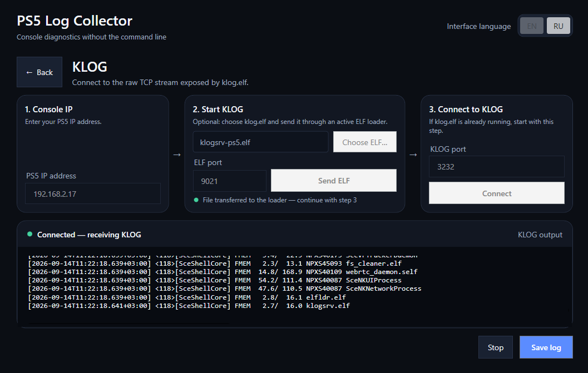

# PS5 Log Collector

[English](README.md) · [Русский](README.ru.md)

<p align="center">
  
</p>

A portable Windows application for collecting KLOG and KStuff/game debug output from a jailbroken PlayStation 5 — without Netcat or command-line tools.

## Highlights

- Connects directly to `klog.elf` / `klogsrv` over raw TCP.
- Provides a separate Game DEBUG session for [`ps5debug-NG` v1.3.0](https://github.com/OpenSourcereR-dev/ps5debug-NG).
- Provides a KStuff Metrics session for metrics-enabled `kstuff.elf` plus `debug-reader.elf`.
- Adds an in-app **SM+** workspace for downloading the saved ShadowMountPlus `debug.log`.
- Keeps the ELF-loader connection open after upload to capture the payload's stdout/stderr stream.
- Detects the foreground game and records structured trap/signal events with thread and register context.
- Optionally sends a user-selected ELF payload to an active console loader on port `9021`.
- Uses port `3232` by default, with an editable host and port.
- Displays incoming KLOG data in a responsive live viewer.
- Adds an ISO 8601 timestamp with milliseconds and the PC time-zone offset to every line.
- Saves the complete session from the moment the connection was established.
- Clears the visible log view without stopping capture; the complete session remains available to save.
- Preserves partial lines when capture is stopped or the remote side disconnects.
- Switches between English and Russian without restarting.
- Remembers the selected language and last endpoint.
- Ships as one self-contained EXE, with no separate .NET installation.
- Does not bundle or invoke Netcat or Telnet.

Example output:

```text
[2026-09-13T22:42:15.123+03:00] kernel: example message
```

## Requirements

- A jailbroken PlayStation 5 capable of running `klog.elf` or a compatible `klogsrv` payload.
- Game DEBUG additionally requires `ps5debug-NG` v1.3.0 running on the console.
- The PC and console connected to the same local network.
- Windows 11 x64 is the primary supported target.
- Windows 10 22H2 x64 is best-effort and should be tested with the current release.

## Quick start

1. Download the latest Windows EXE from the [Releases page](../../releases/latest).
2. Start `PS5LogCollector.exe`.
3. Select **KLOG**.
4. Enter the console IP address.
5. Either activate `klog.elf` manually, or choose your ELF file and select **Send to console** while a compatible loader is active on port `9021`.
6. Keep the KLOG port at `3232` unless the payload uses a custom port, then select **Connect**.
7. Use **Stop** to end capture and **Save log** to export the complete session as UTF-8 text.

Saving is also available while capture is active. Cancelling the Save dialog does not interrupt the connection or discard the session.

### Game DEBUG — KStuff Metrics

1. Select **DEBUG → KStuff Metrics** and enter the console IP address.
2. Optionally choose the matching metrics-enabled `kstuff.elf` and send it through the loader on port `9021`.
3. Choose `debug-reader.elf` and select **Start metrics capture**.
4. The app sends the reader, closes only the upload direction, and reads its stdout/stderr over the same `9021` connection.
5. Select **Stop capture** before closing the payload, then save the complete session.

The reader prints periodic snapshots of kstuff metrics, kstuff message/word logs, syscall statistics, and ioctl-com statistics. The matching kstuff build must expose the shared observation area; the application cannot make an ordinary kstuff build produce these metrics.

### Game DEBUG — Debugger Events

Select **Debugger Events** for the existing `ps5debug-NG` workflow: command port `744`, reverse event port `755`, and structured trap/signal packets. This is a separate diagnostic source and is not the same as KStuff Metrics stdout.

KStuff Metrics captures the reader payload's stdout/stderr, not ordinary game stdout. Classic application/SDK stdout is expected to require DECI5 TTY and remains a later transport. KLOG, DEBUG, and SM+ run as separate sessions in v0.5.0.

### SM+ — ShadowMountPlus ([API reference](https://github.com/drakmor/ShadowMountPlus/blob/1.7/docs/api.md))

1. Open **SM+** in the left navigation and enter the PS5 IP address.
2. Select **Fetch debug.log**. The app first tries the ShadowMountPlus HTTP API on port `10101`.
3. If the API is unavailable, expand the FTP fallback and use the console FTP port (commonly `1337` or `2121`) and the saved path `/data/shadowmount/debug.log`.
   The FTP user field is intentionally blank by default; fill it only when the console FTP service requires a username.
4. Review the downloaded file, then use **Save log** to write the original text without adding timestamps or other lines.

This is a one-shot download of the saved file; live ShadowMountPlus monitoring is intentionally not part of this phase. The HTTP API is normally loopback-only, so ShadowMountPlus must be configured to bind its API to the local network (for example, `api_bind_address=0.0.0.0`). The API has no authentication, so expose it only on a trusted LAN. It may return only the tail when the file is larger than its response limit, and the status bar reports that condition.

## Connection troubleshooting

- **Connection refused:** confirm that `klog.elf` is active and listening on the selected port.
- **Timed out:** verify the PS5 IP address, local network connectivity, and firewall rules.
- **No new messages:** KLOG may be quiet until the console produces new kernel output.
- **Connection closed:** restart the payload if necessary, then connect again manually.

The application uses the same raw TCP stream as:

```shell
nc <PS5_IP> 3232
```

Telnet mode is intentionally not implemented because the upstream service exposes a raw socket rather than the Telnet protocol.

## Privacy and safety

KLOG and Game DEBUG files can contain device identifiers, game identifiers, thread names, memory addresses, filesystem paths, network details, or other diagnostic information. Review and redact logs before posting them publicly.

PS5 Log Collector only connects to the host and ports entered by the user. It does not upload logs, include telemetry, or perform a jailbreak. Payload transfer happens only after the user explicitly chooses a local ELF file and selects **Send to console**.

## Architecture

- `src/Ps5LogCollector.Core` — KLOG transport, ShadowMountPlus HTTP/FTP retrieval, same-socket ELF/stdout capture, ps5debug-NG protocol, session lifecycle, event parsing, temporary spool, and full-session export.
- `src/Ps5LogCollector` — WPF/Fluent interface, localized resources, Save dialog, and persisted user preferences.
- `tests/Ps5LogCollector.Core.Tests` — dependency-free regression suite covering TCP, timestamps, ShadowMount HTTP API parsing, ps5debug-NG framing, event parsing, detach, export, and localization parity.

The live text control retains a bounded recent window for UI performance, while the temporary session spool preserves the complete exportable log.


## Disclaimer

This is an independent diagnostic utility and is not affiliated with, endorsed by, or sponsored by Sony Interactive Entertainment. “PlayStation” and “PS5” are trademarks of their respective owners. Use the application only with systems and software you are authorized to access.
